# HELLSCAPE

> *Everyone in this city has already died once. Die again, and you become one of them.*

**HELLSCAPE** is a first-person narrative horror game built in Unity (URP), with a PS3-era survival-horror look. You are a delivery driver for Kessler & Vane Logistics. You finish a last drop, go home to your brother Derek, and are shot dead in your own living room. You wake in a dark, burnt copy of your city with a mark burning in your hands.

  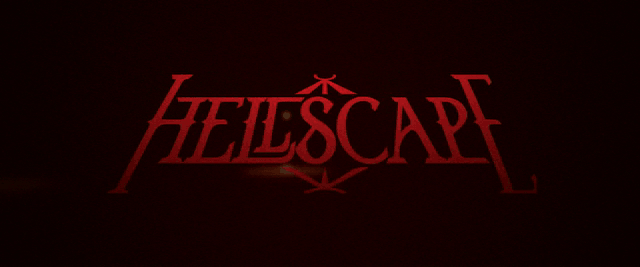

<b><a href="docs/media/trailer/hellscape-trailer.mp4">▶ Watch the trailer (50 s)</a></b>

<b>The game will be released on itch.io.</b> This repository is the source code and the making-of, not a download.

## The story

One more drop, then bed. You sign your route sheet at the office, where Priya, Ben, Nadia and Omar are finishing their day. Mercer hands you a sealed cool box at the dock: Harlow Clinic, keep the seal on, don't stop. You deliver it, pick up Derek's coffee order and go home. The news is talking about medical deliveries. Then there are two gunshots in the hallway, Derek shouts at you to get out, and Mercer says it wasn't supposed to happen in here.

You wake somewhere dark, in front of something the game only calls **HIM**. He tells you to hold out your hands, and then you are back on your own street. It is the same city, burnt and unlit except for the street lamps that still work, and he sends you to the office.

The office burnt with your colleagues inside it. The report says electrical fault. In the red city you find out what was in the boxes, what happened to Tomas, the night cleaner who was going to the police, why Derek ran, and how much of it had your name on the paperwork. Vane died in that fire too. He is still in the building, and he blames you.

In hell, the dead are sorted:

- **The Lost** are the dead who don't know, or won't say, what happened to them. They drift where they died and ask you for their names.
- **The Damned** are what the rest become. They stand in the lamp light and watch.
- **The bridge** at the end of the city is where everyone is judged, you included.

## Features

- **A playable last day.** The prologue is a morning at the office, a delivery run through traffic and rain, and the walk home.
- **A dark city.** Under half the street lamps work and some of those flicker. The Lost and the Damned are in the streets.
- **A burnt office with a memory.** Press V to blink into the **Echo**, the office as it was before the fire. Some doors, evidence and conversations exist only there, and each visit lasts about six seconds.
- **Vane hunts you.** He patrols the office the whole time. He sees less of you when you crouch, hears you walk when he is close, and hears you run from further off.
- **Hide and hold your breath.** Crouch in a dark pool and he cannot see you. If he comes to search it, hit Space in time with your heartbeat. Miss twice and he has you.
- **Marked hands.** Your palms are your torch, and a charged flash blinds Vane long enough to get away.
- **Four colleagues to free.** Find each one's evidence, see their memory in the Echo, then tell them the truth and send them to the bridge.
- **Recovered CCTV.** Restore the power, get into Vane's office, and watch what the cameras kept.
- **The silo.** A ledger with no full names, Tomas's tape, a tag with your own name on it, and a fight with Vane at the bottom.
- **A flood of blood** that rises up the silo behind you.
- **A van escape.** The office comes down, Vane walks out of it in his final form, and you drive for the bridge with him in the corner of the frame.
- **A bridge fight.** Blood shards, ground slams, corrupted pools and a shield of bodies, varied by phase.
- **Diegetic UI.** An ECG strip for your health, a round map on the delivery run, and a van that shows its damage on its bodywork.
- **Resident Evil-style door transitions** between areas.

## Game mechanics

### The dead
- **The Lost** can be talked to. In the office they are your four colleagues, each stuck on the last thing they were told.
- **The Damned** stare, follow and shove. They are not there to be fought.
- **Freeing a colleague** takes three things: the evidence about them, their memory in the Echo, and you telling them what really happened.

### In the office
- **Power first.** The breaker is in the electrical room and its fuses are missing. Until they are back, the only light is your hands and the windows.
- **The Echo.** Press V and your eyes close, the office changes behind them, and they open on the clean memory. A countdown shows how long you have. Doors that are jammed in the burnt office may open there.
- **Vane.** He walks between rooms, stops, looks about, and sometimes searches the dark corners. If he sees you he runs, and he is faster than your walk.
- **Hiding pools.** Dark patches in the corners. Crouch inside one to disappear. When he searches yours, the breath game starts.
- **Caught.** He chokes you and the screen closes in. Mash Space to break his hold, or flash him. It gets harder every time he catches you.
- **CCTV desk.** Live feeds once the power is on. The recorder needs a security card, which is in Vane's office, which is jammed shut.
- **Kessler's office.** A keypad whose code is on one of the tapes, and an armory behind it.
- **Health.** No number. It comes back on its own after a few seconds without being hurt.
- **Objectives.** The current one folds away to the top left. Press O to read it again.

### On foot
- **Fists, then a pistol.** Kessler's Beretta has limited ammunition and has to be reloaded. Against Vane it only buys you time.
- **Crouching** makes your steps silent and raises your hands to block.
- **Readable notes.** Ledgers, rotas and reports carry the clues and the backstory.
- **Evidence journal.** What you find is kept in the journal (J).
- **Checkpoints.** Dying sends you back to the start of the current section, not the start of the game.
- **Skip cutscenes.** Hold Space to fast-forward any cutscene.

### In the van
- **Deliveries.** The prologue run goes through live traffic and pedestrians, with a round map and markers for each stop.
- **Damage you can see.** The van has no health bar. Its bodywork dents and scrapes.
- **The escape.** The road from the office to the bridge is played in third person, with fixed cinematic cameras behind the van.
- **Drive-by shooting.** Hold right mouse to aim out of the driver's window and fire.

### The boss: Vane
- **Three forms.** The man in the office, the thing in the silo, and what walks out of the collapsing building.
- **Blood attacks.** Shards thrown in volleys, a cone smash along the ground, pools that corrupt and give off fumes, and thrown body parts.
- **The shield.** In the hearts phase he is wrapped in blood and body parts. Break the hearts to bring it down.
- **Lose the van and the fight goes on.** You finish it on foot.
- **After the fight** you are called forward and judged.

## Gameplay

| | |
|---|---|
| 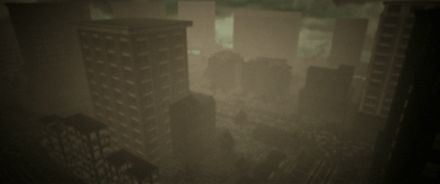 | 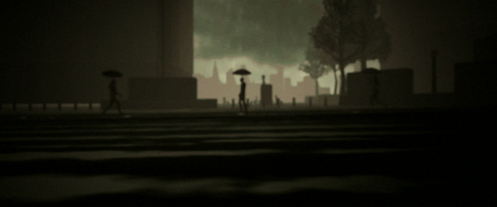 |
| **Prologue:** the city the morning before | **Rain** on the last delivery run |
| 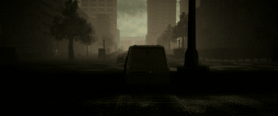 | 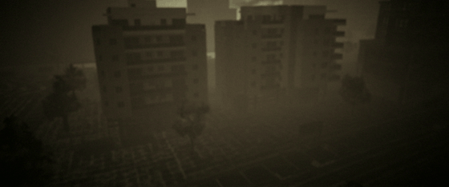 |
| **The night shift:** the last drops | **Home:** the block where it happens |
| 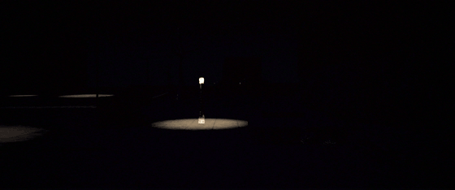 | 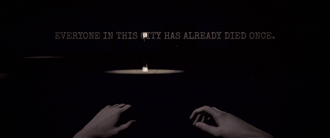 |
| **The city:** only the street lamps still work | **On foot:** you wake up in it |
| 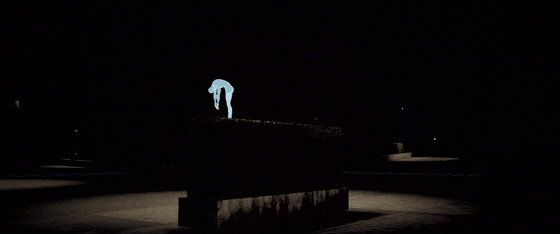 | 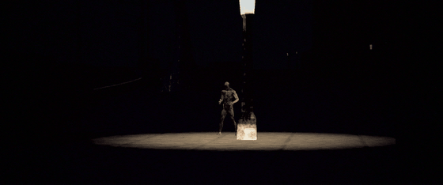 |
| **The Lost** drift where they died | **The Damned** wait in the light |
| 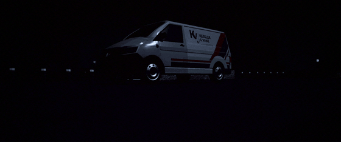 | 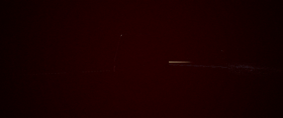 |
| **Kessler & Vane Logistics:** your van | **Escape:** drive, and don't look back |
| 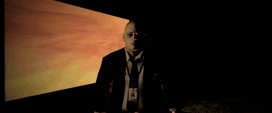 | 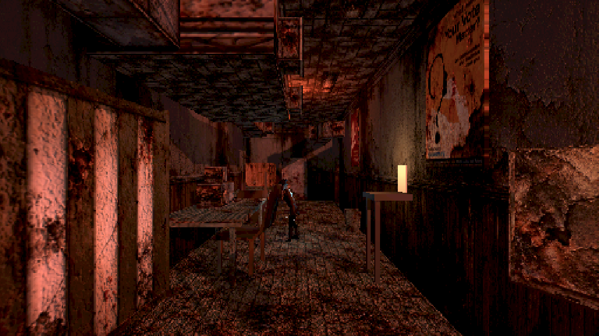 |
| **Vane** is still in the office | **The burnt office** in the red city |

## Controls

| Action | Key |
|---|---|
| Move / look | WASD / mouse |
| Interact | E |
| Blink into / out of the Echo (office) | V |
| Evidence journal | J |
| Raise your hands (palm light) | Q |
| Flash, with hands raised | Left mouse |
| Sprint | Left Shift |
| Crouch / hide | Left Ctrl |
| Hold your breath, break a choke | Space |
| Objective | O |
| Office map | M |
| Fast-forward a cutscene | Hold Space |
| Punch / shoot | Left mouse |
| Aim from the van | Hold right mouse |
| Reload | R |
| Inspect your hands or the pistol | I |
| Get in / out of the van | F |
| Reset a stuck van | Hold T |
| Pause | Esc |

## About this repository

This repository shows how HELLSCAPE is made. It holds the game's own C# scripts and shaders, the design notes, and the trailer and screenshots. It does **not** hold the models, scenes, textures, audio or the third-party plugins, so the project cannot be opened and played from here. To play the game, get it from itch.io.

| Folder | What is in it |
|---|---|
| `Assets/Scripts/` | Gameplay code: the player, the van, cutscenes, dialogue, UI and the ending |
| `Assets/Scripts/Office/` | The office and silo: Vane's hunt, the Echo, puzzles, CCTV tapes, the bridge boss |
| `Assets/Scripts/Prologue/` | The last day: the office morning, the delivery run, the walk home |
| `Assets/Scripts/Editor/` | Editor tools that build and check the scenes, and the Play-mode test robots |
| `Assets/Shaders/` | The game's own shaders |
| `docs/` | Story, system and lighting notes written during development. Some describe earlier versions |
| `Packages/manifest.json` | The Unity packages the project uses |

### How it is put together

- **Three scenes.** `Prologue` is the last day, `MainGameScene` is the red city, the escape and the bridge, and `OfficeSilo` is the office and the silo. Doors load one scene from another and progress is carried across in memory (`SceneProgress.cs`).
- **Story state.** What you have found, seen and said is a set of named flags (`Truth.cs`). The colleagues, the tapes and the ending read from it.
- **Dialogue.** Every line lives in a CSV and is looked up by trigger (`HS5.cs`), so the script can be edited without touching code.
- **Vane.** The office has no navmesh. `VaneHunt.cs` builds a grid of the floor from the colliders and walks A* paths over it, with sight, hearing, the hiding pools and the breath game on top.
- **The Echo.** `EchoVisit.cs` and `EchoOfficeMemory.cs` swap the burnt office for the clean one on a timer and keep what you did there.
- **Checkpoints.** `Checkpoint.cs` puts you back at the start of the section and cancels whatever cutscene or puzzle was running.
- **Scene building.** Much of each scene is placed by editor scripts under the **HellScape** menu, so a set piece can be rebuilt after its models change.
- **Tests.** Play-mode robots under **HellScape > Tests** walk through the story, the scene doors, checkpoint retries and the start of the escape.

### Engine, packages and plugins

- **Unity 6** (6000.3) with the **Universal Render Pipeline**, Forward+.
- **Unity packages:** Input System, AI Navigation, Animation Rigging, Timeline, glTFast, TextMesh Pro, UGUI.
- **Asset Store and third-party plugins:** PROMETEO Car Controller, Modular First Person Controller, PSX Shader Kit, Simple Water Shader by IgniteCoders, Unity Particle Pack, Fists 2025 First Person Animations by 1Matzh, Apartment Kit and Basic Assets by Brick Project Studio, Demo City by Versatile Studio.

## Status

In development. The current build ends on **TO BE CONTINUED**.

## Credits

Built with Unity 6 (URP, Forward+). Fonts: Barlow, Special Elite, Nosifer, Source Sans 3 (OFL) and Perfect DOS VGA 437.

### 3D models

Models from [Sketchfab](https://sketchfab.com), used under the licence shown. The list covers every version of the game, so a few entries are no longer in the current build. CC BY is [Creative Commons Attribution 4.0](https://creativecommons.org/licenses/by/4.0/); some models have been modified (scaled, retextured or rigged) for the game.

| Model | Author | Licence |
|---|---|---|
| [Characters_psx (pedestrians, Elias)](https://sketchfab.com/models/d940162487c3493b9e203d624fdd763a) | Elbolillo | CC BY |
| [High School Character \| PS1 PSX](https://sketchfab.com/models/d96f74f0dc6f49559083c110fef37e2f) | crimsongcat | CC BY |
| [Jason Voorhees Machete Stab Animation](https://sketchfab.com/models/98c47191eaa64d7c907d474af8c251a4) | JasonKills | CC BY |
| [Tommy Jarvis Multiple Stab Animation](https://sketchfab.com/models/7417773a94104a62a0ca157db0cb788f) | JasonKills | CC BY |
| [Tillagemon Boss Skeleton](https://sketchfab.com/models/5c83cdeb86404e63900c1d04f8b391fb) | Vasian-Digital3D | CC BY |
| [HellDemon Reborn](https://sketchfab.com/models/43e163c12f304a35b1f85476ca2549f6) | ArtistForge16 | CC BY |
| [Cursed Rune Demon](https://sketchfab.com/models/0d2348598de9425b95e3a9a1cb915b79) | PolyGoreStudio | CC BY |
| [Vision Monster](https://sketchfab.com/models/fe7ee29fadd14c76856df469d46e9570) | Christian (cristianrm650) | CC BY-SA |
| [Animated Zombie Cop Running Loop](https://sketchfab.com/models/cd221e2b23b14798abf3afb2f31c123b) | LasquetiSpice | CC BY |
| [Polyart Zombies with Animations Free Pack](https://sketchfab.com/models/d9bcfdd88f5348549bc947226af7c314) | Denys Almaral | Free Standard |
| [PSX First Person Arms](https://sketchfab.com/models/efd731f559a14ab48e29c8a200d71788) | Drillimpact | Free Standard |
| [AK74U \| Free Animation](https://sketchfab.com/models/2ab66220c48b465e9501067667965569) | BURNER | CC BY |
| [household knife low poly](https://sketchfab.com/models/5c9e9045a500422a98a7d0e2ad3022f2) | Bowen154 | CC BY |
| [Heart - animated anatomical 3d model](https://sketchfab.com/models/dedbab26bd27413eaf55148caaccc9f7) | assetfactory | Free Standard |
| [Stylized pixel Fiat Ducato gen. I [JACEX]](https://sketchfab.com/models/7687ffd0ba6f4783a0486007f7eb6531) | Pyromma-GS | CC BY |
| [PSX Bus](https://sketchfab.com/models/b16ea5da83d14981a5dc2d8d199a1efd) | Namahoi | Free Standard |
| [PSX Sedan Car](https://sketchfab.com/models/90bbcad62e0d480581bf0a191b2f6bd2) | jonniemadeit | CC BY |
| [1976 Ford Fiesta Mk1](https://sketchfab.com/models/08f1f2b0c40e46628fde4cf4a34ccb4d) | ImperialBlue3D | CC BY |
| [2004 Honda S2000 (AP1)](https://sketchfab.com/models/43e6eee38fa6459e9b452a038a1f95c4) | ImperialBlue3D | CC BY |
| [PSX Passat LS 1978](https://sketchfab.com/models/f56cc9a3ff76418fb30ece32d063f608) | Charckes | Free Standard |
| [Chevrolet Caprice Police](https://sketchfab.com/models/6ad082c3f89b474e80dbd85640a79dce) | zairiq zairiq 8 | CC BY |
| [Grandma Rides A Vintage Vespa](https://sketchfab.com/models/9739af3d127649b684da4016f1ad092e) | Fadly.W | CC BY |
| [Lowpoly mobile cartoon office rooms](https://sketchfab.com/models/6ba30f362a774ac38e8635e0eb94f5f0) | endike | CC BY |
| [Low Poly Office Cubicle Assets](https://sketchfab.com/models/f430770d9ba5480a89b3e355d05f9385) | NobleCrowDev | CC BY |
| [Modern Furniture Pack](https://sketchfab.com/models/11bd2dcb9ec14142bc92968c2a85c029) | fangzhangmnm | Standard |
| [Hospital Reception Environment](https://sketchfab.com/models/3d5b0ae00f9b4e2dad266fa0cd4748cb) | CaseyPozzobon | CC BY |
| [Room Door Animation](https://sketchfab.com/models/e85909e80635445b92fb80772af80c84) | 3DHaupt | CC BY-NC |
| [Mostrador (Counter)](https://sketchfab.com/models/85235b6da261497b922469f76910f5f2) | franciscomedina77 | CC BY |
| [Crates And Barrels](https://sketchfab.com/models/5ae3c72285474862a89d69c2f2ad2246) | SpatialNeglect | CC BY |
| [Free Barrel](https://sketchfab.com/models/8aeb266118304c7d891096be038e1de7) | rakshigames | CC BY |
| [Body Bag](https://sketchfab.com/models/bf0523a2f4c24ed9ad936c40de1b7ae5) | AlienKat | CC BY-NC |
| [Blood Pool Location](https://sketchfab.com/models/cc522076671a436a990d680d42417aa1) | Veterock | CC BY |
| [blood decals psx](https://sketchfab.com/models/d036a3b7b3d24e2d84b06905f3d301fe) | dohnjoe | CC BY |
| [Bridge_ Metal_10_MB](https://sketchfab.com/models/5933ffc71ca5427da825715660fa16d8) | Mehdi Shahsavan | CC BY |
| [Old Modular Bridge](https://sketchfab.com/models/7118bbbcc66b407b80047c3c051a1d39) | CGMeller | CC BY |
| [Tunnel Road](https://sketchfab.com/models/9022ca0e48924aad96123389d5322a7d) | Low poly 3d Models | CC BY |
| [Tunnel](https://skfb.ly/6RBvx) | Helsingr | CC BY |
| [Mid rise wall to wall office building](https://skfb.ly/6WMBF) | aitortilla01 | CC BY |
| [Birthday Cake](https://skfb.ly/opxsU) | Sakthivel G | CC BY |

Other sources:

- **Animations:** [Mixamo](https://www.mixamo.com) (Adobe), including the Scary Zombie Pack character and animations.
- **Unity Asset Store:** see the plugin list above.
- **Free-to-use models:** the walking man and woman pedestrians.
- **Generated characters:** the colleagues, Vane, Mercer, the delivery customers and the King were made with Meshy and rigged for the game.

The Kessler & Vane office was built from scratch for HELLSCAPE, as were the K&V Logistics logo, the fuse box, the blood orb, the Sci-fi Core, Shadowchain and the Confessors.

Third-party audio belongs to its respective authors.
