# HELLSCAPE

> *Everyone in this city has already died once. Die again, and you become one of them.*

**HELLSCAPE** is a first-person narrative horror game with a PS1/PSX look, built in Unity (URP). You are a night-shift delivery driver for Kessler & Vane Logistics. You walk home one morning and find your brother Derek dead. You chase his killer, Elias, to the roof, and the fall wakes you in a red, burnt version of the city.

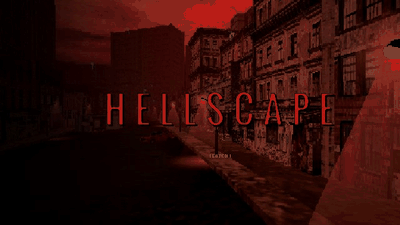

## The story

You deliver parcels all night for Kessler & Vane. A cool box with no label. A back door at a clinic. Your brother Derek looked scared. At 7:12 AM you clock out and walk home, and what you find there makes you chase a killer to the roof.

In the red city you learn what Derek really did for Kessler & Vane, what happened to Tomas, the night cleaner, and how much of the cover-up was your own work. Most of the truth is in the burnt office, where Vane is still waiting.

In hell, the dead are sorted:

- **The Lost** are the dead with hidden sins. They drift as blue ghosts.
- **The Damned** are the ones whose sin came out, spoken aloud. They are what hunts you.
- **The bridge** at the end of the city judges everyone, you included.

Your choices decide how that judgement goes: who you spare, who you take with you, and whether you make people confess.

## Features

- **Choices that count.** Dialogue answers, mercy or violence, and who you save all feed into a final verdict.
- **An office act with puzzles.** Restore the fuses, crack the keypad, and piece together the CCTV footage in the burnt Kessler & Vane office.
- **The Echo.** Press V to blink into a clean memory of the office before the fire. You only get a few seconds before your eyes close again.
- **An office that fights back.** It gets worse each time you get something right: lights stutter, phones ring, bodies go missing, and the Auditor watches from the ends of corridors. The Eye patrols the dark with a red beam.
- **A tunnel chase.** Kessler, turned, breaks down the door behind you and chases you through a service tunnel hung with swinging body bags.
- **A chase through the silo complex.** A killer who drops in behind you, ladders, a lift, a spiral stair, and a jump into the dark.
- **A flood of blood.** Mash to swim up through it, and decide who you pull out with you.
- **A van escape and a boss fight.** Drive the Kessler & Vane van down the road through a horde of the damned. Lean out and shoot from the window while **Tomas, the Amalgamation** hunts you, then fight it in a bridge arena.
- **Survival-horror cinematic cameras.** The van chase cuts between fixed set-ups, RE/PS2 style.
- **Diegetic UI.** A beating anatomical heart and a van that dents and smokes, with no health numbers.
- **Resident Evil-style door transitions** between areas.

## Game mechanics

### Judgement
- **Karma from conversations.** Every ghost offers several answers, some kind and some cruel. Each one is counted.
- **Kill or spare.** When the killer is on his knees, the choice is yours, and the story branches on it.
- **Who you save.** Colleagues you pull out of the flood, and those you leave, weigh on the verdict.
- **The verdict.** At the bridge, the ending is built from what you actually did.

- **Witnesses.** Your four dead colleagues each have a desk. Question them in the red city and again in the Echo. Denial leaves them **Lost**, justification makes them **Damned**, and owning up leaves them **Confessed**, and their testimony goes in your journal.
- **Evidence.** Clues you find go into an evidence journal (J). Holding the right evidence changes what you can put to Vane.

### The dead
- **The Lost** drift and whisper. You can talk to them.
- **The Damned** wander, lie dormant, feed, or crawl. They hunt by sight and by sound, scream before they charge, and alert the others nearby when hit.
- **The second death.** Anyone who dies again in the red city comes back as one of the Lost or the Damned, including people you failed to save.

### In the office
- **The Echo.** Press V and your eyes close, the office changes behind them, and they open on the clean memory. Each visit lasts about six seconds, with a countdown at the top right. Some puzzles can only be solved in the Echo, and your progress there is kept between visits.
- **Escalation.** The **horror director** pushes the office through stages with each fuse, the keypad and each piece of evidence: stuttering lights, ringing phones, a printer printing, missing bodies, the Auditor, and finally a corrupted Echo.
- **The Eye.** A floating guard does the rounds with a red beam. Stay out of its sight or put a desk or wall between you. It can't be killed, but a flash from your palms blinds it.
- **Palm light.** Before the power is back, press Q to raise your marked hands as a torch.
- **Colleagues.** Walk up to a desk and you hear footsteps behind you. Look back and there's nothing there. Look forward again and the burnt body is standing in front of you.
- **Minimap.** A round minimap of the office floor at the top right, and M shows the whole floor.
- **Vane.** He only moves when you aren't looking. Put the evidence to him, then run.

### On foot
- **Fists and a rifle.** Jabs chain left and right. The rifle comes later, has to be reloaded, and fires a little slower than it used to.
- **Puzzles.** Find the fuses to restore power, work out the keypad code, put the CCTV route in order, pick a lock (swing the pick, hold Space to turn) and wind the silo door's jammed knob by tapping A and D while Tomas holds Kessler off.
- **Readable notes.** Ledgers, rotas and reports carry the clues and the backstory.
- **Chase sequences.** Ladders, a lift you have to call, an ambush and a blind leap, with the killer a few metres behind. In the tunnel, Kessler is the one chasing you.
- **Elias.** He dodges shots while walking, charges and stuns himself on the walls, and throws knives you can pull out of the wall and throw back. He also drops health orbs.
- **Swimming the flood.** Mash Space to keep your air up while the blood rises. Colleagues cling to you, and if your air runs low they drown first.
- **Checkpoints.** Dying sends you back to the start of the current act, not the start of the game. Retrying no longer leaves the camera stuck.
- **Skip cutscenes.** Hold Space to fast-forward any cutscene.

### In the van
- **Deliveries.** The prologue is a morning delivery run through live traffic and pedestrians.
- **Damage you can see.** The van has no health bar. Its paint dents and scrapes, and it smokes when it is close to wrecked.
- **The horde.** The damned grab onto a slow van and tear at it. Keep moving and swerve to throw them off.
- **Drive-by shooting.** Hold right mouse to lean out of the window and fire. Middle mouse locks onto the boss's heart.
- **Ramming.** Hitting the boss at speed hurts him.
- **Cinematic cameras.** The chase cuts between side, kerb, crane and front cameras on its own. In the tunnel the camera is fixed to the van's bonnet.

### The boss: Tomas, the Amalgamation
- **The fusion.** Tomas gathers the ruined Damned bodies of Vane and Maya and joins them to himself, making a three-headed monster. Tomas speaks for it, and Vane and Maya are separate voices inside it.
- **Phases** with rolling blood orbs dropping in two rings around the centre, beams, slams, charges and the drowned climbing the rails.
- **Black hearts.** In the last phase he is sealed in a purple liquid shield and tethered to black hearts on the deck. Shoot the hearts to bring the shield down.
- **A weak point.** His exposed heart takes triple damage.
- **Charges can be punished.** Dodge one and he is stunned.
- **Lose the van and the fight goes on.** You finish it on foot.
- **After the fight.** Each of them gives an account, and the King weighs yours. In the Bound ending you look down at your fists as the Demon King's mark burns into the back of each hand.

## Gameplay

| | |
|---|---|
| 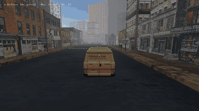 | 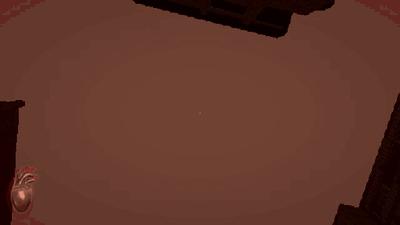 |
| **Prologue:** the last delivery run | **Waking up** in the red city |
| 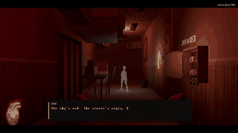 | 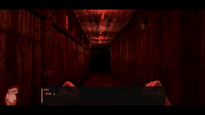 |
| **Office act:** the dead still talk | **Silo chase:** he is right behind you |
| 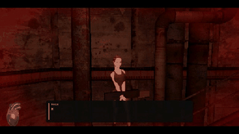 | 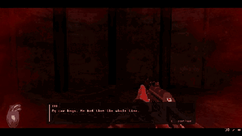 |
| **Silo fight:** a rifle from above | **The blood flood:** swim or drown |
| 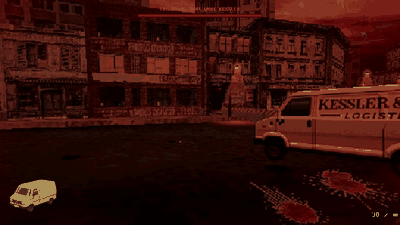 | 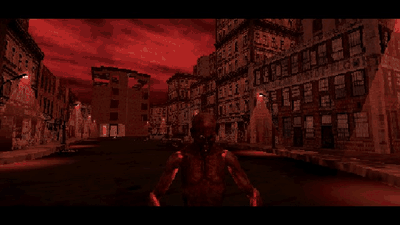 |
| **Escape:** the van and the horde | **The bridge boss** |
| 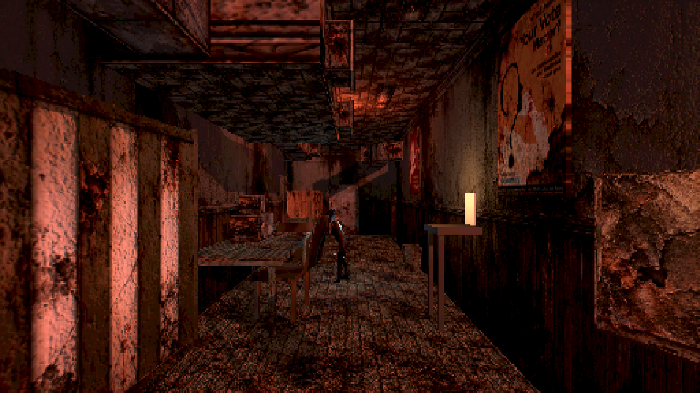 | 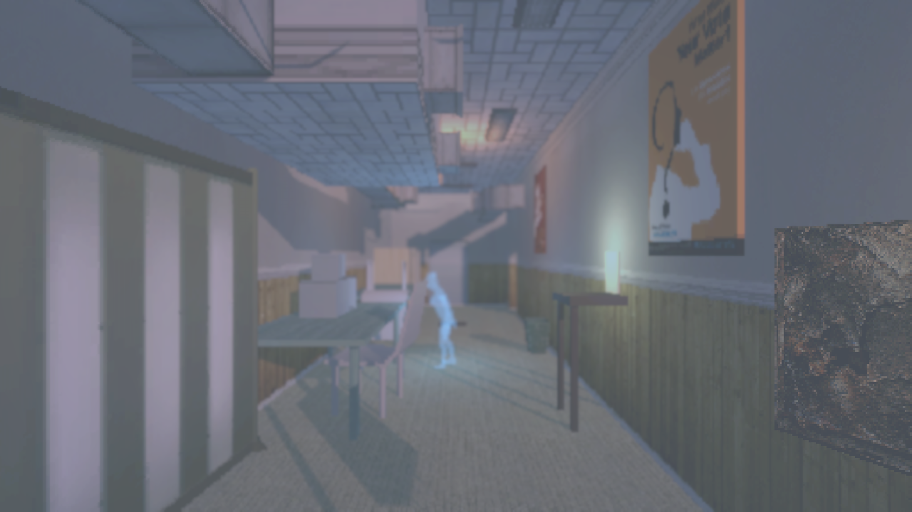 |
| **The burnt office** in the red city | **The Echo:** the same room, before the fire |
| 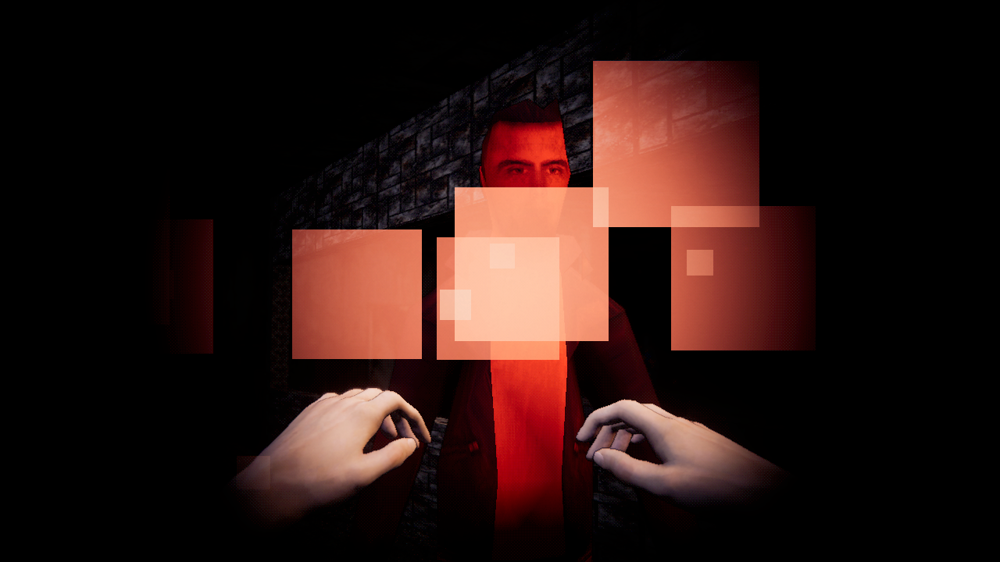 | 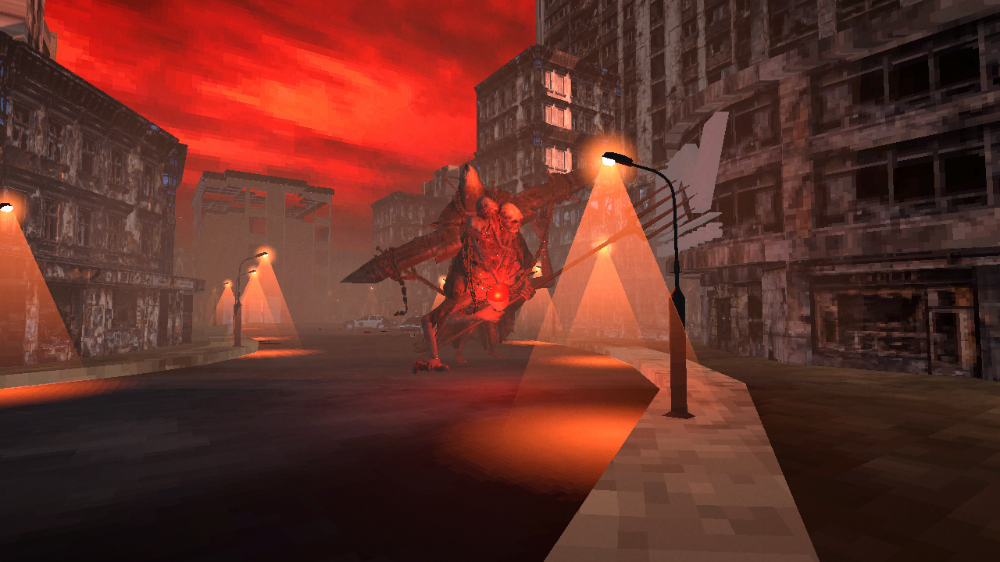 |
| **Vane** when you look away | **Tomas, the Amalgamation** |

## Controls

| Action | Key |
|---|---|
| Move / look | WASD / mouse |
| Interact | E |
| Blink into / out of the Echo (office) | V |
| Evidence journal | J |
| Palm light (dark office) | Q |
| Office map | M |
| Fast-forward a cutscene | Hold Space |
| Punch / shoot | Left mouse |
| Aim from the van | Hold right mouse |
| Lock on the boss | Middle mouse |
| Reload | R |
| Get in / out of the van | F |
| Reset a stuck van | Hold T |
| Pause | Esc |

## Running the project

1. Install **Git LFS** (`git lfs install`) *before* cloning, or the models and audio will be tiny text stubs.
2. Clone the repo and open the folder in Unity.
3. Open `Assets/Scenes/Prologue.unity` and press Play. `MainGameScene` is the main game.

Quick-start menus jump straight to a section:

- **HellScape > Play > Car Chase (from the garage)**
- **HellScape > Play > Kessler Chase (tunnel)**
- **HellScape > Play > Elias Fight (silo floor)**
- **HellScape > Play > Final Boss (black hearts phase)**

### Dialogue

All dialogue is in `Assets/Resources/HellscapeDialogue.csv` (columns `id, speaker, text, trigger, condition, effect`). Edit lines there instead of in code. **HellScape > Tests > Dialogue CSV** checks the file.

### Tests

Play-mode regression checks run on throwaway scene state and never save the scene:

- **HellScape > Tests > Story regression (Play mode)**: conversations, witnesses, the Echo, realm puzzles, the CCTV-to-Vane handoff, the escape and cleanup
- **HellScape > Tests > Tomas amalgamation (Play mode)**: both Elias branches, the fusion, the boss handoff and the final accounts
- **HellScape > Tests > Checkpoint retry**: respawning after a death

Results are written to `Library/*.result`.

### Design docs

Story, systems and audit notes are in [`docs/`](docs/): the story rebuild, Echo office, office horror, Tomas finale, dialogue trigger map, and testing checklist.

## Recent changes

- **Kessler & Vane office.** A new office model with low-poly supplies. The old office export and the furniture pack archive were removed, and `.rar` files are now ignored.
- **Dialogue moved to a CSV.** All lines are in `Resources/HellscapeDialogue.csv`.
- **The Eye and the colleague scare** added to the office, and the stuck camera after a checkpoint retry is fixed.
- **Revised plot.** Vane is in the office, there are new prologue beats, and dialogue and choices are fixed. A story regression test was added.
- **Office horror layer.** A stage director, the Auditor, burnt bodies, and witnesses who end up Lost, Damned or Confessed.
- **The Echo office.** Blink into the clean memory on a timer, with realm puzzles and an evidence journal.
- **Tomas, the Amalgamation** replaces Kessler as the bridge boss, with a boss shield and black hearts.
- **New puzzles and quality of life.** A lock-pick puzzle, the silo door knob, cutscene fast-forward and an office minimap.
- **Kessler's tunnel chase.** No fight in the office: he drops the silo key and chases you through a tunnel of hanging body bags.
- **Elias reworked.** Dodges, wall-stun charges, throwable knives and health orbs.
- **Bound ending.** The Demon King's mark burns into your hands, and the ending track is now *Run To You*.
- **Boss tweaks.** Orbs fall in two rings around the centre, and the beam count is a setting.
- **End screen restyle.** HELLSCAPE in the title lettering, TO BE CONTINUED along the bottom, and Enter returns to the title.
- **Audio.** New music and sound effects wired into the Sound Library.
- **Tweaks.** The drive-by aim has a wider pitch range, hands are hidden on ladders, the rifle fires slower, and Maya's aim no longer jitters.

## Status

In development. The current build ends on **TO BE CONTINUED**.

## Credits

Built with Unity (URP, Forward+). Fonts: DOS Pixel, Oswald, Nosifer, Source Sans 3 (OFL). Third-party models and audio belong to their respective authors.
