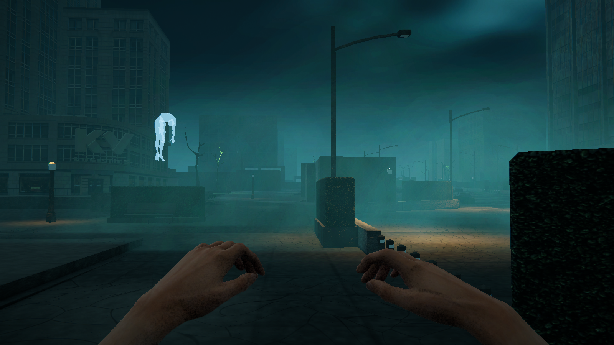
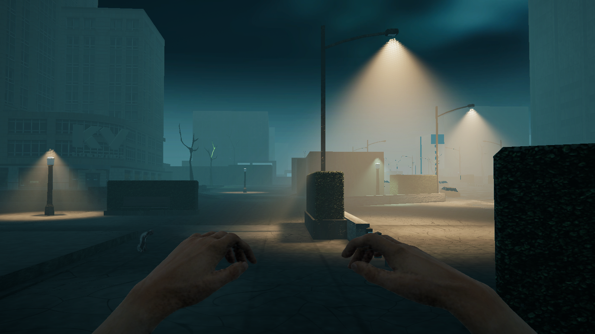

# HellScape cinematic atmosphere implementation

Implemented in the existing Unity 6000.3.24f1 project with URP 17.3.0, Forward+ and Render Graph. No packages were installed. City geometry, object poses, physics, navigation, interactions, story and AI scripts were preserved.

## Result

The existing Dead City lighting now has a dedicated cinematic profile, cooler environmental fill, heavier distance separation, isolated warm spotlights, real local light scattering, selective wet asphalt, restrained green tree lighting, thinner low mist and time-sliced existing reflection probes. The original material/realm switch remains in charge. The worn-road shader was extended to respect explicitly mapped wet smoothness while keeping its original matte materials unchanged.

Only MainGameScene's existing player and vehicle cameras select the additional cinematic renderer. Camera transforms, FOV, anti-aliasing and the original default quality renderers are preserved. Each quality pipeline only gained an extra renderer entry.

## Matching Game-camera images

Both pairs use the actual PlayerCamera, FOV 60, at 1600x900. The original scene checkpoint was replayed to export consistent display-referred sRGB images; the initial linear baseline capture is retained separately. Moving particles, enemies and hand animation can differ between frames.

- Benchmark: position (-10, 2.8, 28), look target (12, 5, 85): [before](before-display-street.png), [after](after-display-street.png).
- Eastern street: position (0, 3.2, 56), look target (95, 7, 50): [before](before-display-east-street.png), [after](after-display-east-street.png).

## Exact final settings

[lighting-values.json](lighting-values.json) records the full configuration and ownership rules.

| System | Final values |
|---|---|
| Ambient gradient | Sky #3A565B; equator #263D41; ground #10191C |
| Directional | #819FA6, intensity 0.15, soft shadows 0.85; original orientation |
| Exploration fog | Exponential, #344F51, 0.008 |
| Dense street fog | #485B59, 0.016; bounds center (-90,3,65), size (12,8,24), on a raycast-checked existing street |
| Driving fog | #29494C, 0.0035; smooth blend rate 0.8/s |
| Danger driving | Visibility density 0.0035 during active driving chase; existing crimson colour/sky/sun/grade retained; opening cameras, arena and external fog overrides take priority |
| Local scattering | Half width/height RGBA16F, 32 integration steps, anisotropy 0.35, strength 0.055, 80 m, up to six visible streetlights |
| Resolve and occlusion | Four-tap depth-aware additive resolve; camera depth and existing URP additional-light shadow maps |
| Temporal accumulation | Not implemented; stable spatial dither avoids history trails across Echo/camera cuts |
| Lamps | 407 existing working lights retained; nearest 28 active; 35 shadow-capable, including prototype lamps |
| Lamp palette | Amber #D8AA72; sick green #B5DBAA; broken/off lights retained |
| Lamp intensity | Amber 2.5 × height², green 1.5 × height²; ground height excludes pole colliders and is clamped to 4–14 m, using the project's existing light units |
| Lamp range/angles | clamp(2.2 × height, 12, 28) m; outer 105°, inner 65° |
| Lamp shadows/cookie | Strength 0.8; bias 0.08; normal bias 0.25; medium resolution; soft irregular 128² cookie |
| Wet asphalt | Original Worn Road shader/textures/weathering; metallic 0; packed smoothness mask approximately 0.215–0.85; multiplier 1; no new road/puddle geometry |
| SSAO | Existing feature, intensity 0.65, radius 0.30, Depth Normals, Medium samples/blur, half resolution where the quality renderer already has SSAO |
| Pooled tree lights | Base intensity 22, range 10 m, nearest eight, no shadows; original green flipbooks preserved; existing per-tree variation/flicker retained |
| Mist | Alpha 0.08; width 12–22 m, billboard height 0.65–1.3 m; global emission 12/s, pockets 2/s, at most 100/system; very slow drift; 2 m soft depth fade; existing 10–18 m clear halo; far fade 85–120 m |
| Ocean | Deep #071719, surface #102D32 alpha 0.863, smoothness 0.15; existing shader/waves/gameplay retained |
| Reflection probes | Existing 13 volumes/poses retained; realtime OnAwake, IndividualFaces time slicing, resolution capped at 128, box projection |
| Grade | ACES; exposure -0.20; contrast +16; saturation -16; filter #E5EDE9; white balance -7 / 0 |
| Bloom | Threshold 1.15; intensity 0.22; scatter 0.60; HQ off |
| Other post | Vignette 0.18 / smoothness 0.45; chromatic aberration 0.01; Motion Blur, DoF and Lens Distortion visually off |
| Film grain | Thin1 0.06 through the existing accessibility-aware RetroLook toggle; other scenes retain their original 0.15 |

This is local light scattering, not a global glowing fog overlay. Non-shadow-casting lamps still use scene depth for camera occlusion; complete light-space occlusion is available on selected shadow-casting lights. Existing water depth limitations are respected by avoiding new shoreline particle blankets. No SSR or planar-reflection dependency was introduced.

## Validation

The corrected Play Mode integration run passed exploration ownership, six-light scattering selection, lamp pool limits, cinematic fog ownership, ordinary vehicle entry/exit, driving fog (observed 0.003536398 after settling), selected dense fog, BloodTide/return, and the original bridge LightArena coroutine. Bridge fog reached 0.000002286 and its original sun reached 0.749829. See [runtime-validation.txt](runtime-validation.txt).

That run initially looked for Echo in MainGameScene; the actual blackout/Echo interior belongs to OfficeSilo and is tested separately. The earlier combat-interrupted run is retained as evidence and is not used as a passing result. Ordinary driving tests temporarily hold encounter entry callbacks, restore them immediately, and leave the production events intact.

CHECKPOINT_COMPARISON_PENDING

ECHO_VALIDATION_PENDING

ENCOUNTER_VALIDATION_PENDING

MOVEMENT_VALIDATION_PENDING

The Render Graph Viewer was opened in Play Mode and showed one existing SSAO pass plus HellScape Local Scattering (32 steps, half) and HellScape Scattering Depth Resolve after opaque/sky rendering and before subsequent transparent/post passes.

## Measured performance

RTX 2060, Ultra, 1920x888 Game view, VSync on. The final same-session comparison used 180 distinct frames plus 45 warm-up frames per configuration:

| Observation | GPU frame median | Game-frame median | Draw calls median |
|---|---:|---:|---:|
| Final, scattering on | 7.661824 ms | 23.341801 ms | 829 |
| Final, scattering off | 7.432192 ms | 22.805798 ms | 830 |

Observed same-run difference: approximately **0.23 ms GPU** for scattering. Dynamic scene activity can contribute to this small difference; this is one Editor observation, not a standalone benchmark or a guarantee.

The original baseline recorded 12.1888 ms frame median, 693 draw calls and a single available 3.762176 ms GPU timing. Those before/after totals are not a controlled comparison: the Editor was restarted with two job workers after import-worker crashes, scene activity differed, and the baseline sampling method differed. The complete look adds selective shadow work and wet reflection sampling. No standalone build performance claim is made. Raw observations are in [before-performance.txt](before-performance.txt), [after-performance.txt](after-performance.txt), and [after-without-scattering-performance.txt](after-without-scattering-performance.txt).

## Changed files and safety

[FILES.md](FILES.md) lists every changed script, scene, pipeline asset, renderer copy, volume profile and created material/texture. Matching Unity .meta files accompany new assets. [scope-check.json](scope-check.json) compares the final scene against the live pre-task checkpoint: all 9,830 protected transform/camera/mesh/physics/navigation blocks and prefab transform overrides must match, and original DeadCity assets/renderers must remain intact. Re-run `python Tools/verify_cinematic_scope.py` from the project root.

No new manual Inspector assignments or external asset dependencies are required. The dedicated references were assigned in the scene and renderer assets. Existing gameplay problems found by regression are reported above rather than silently changed.

## Recovery and maintenance

`Backups/CinematicAtmosphere-20261030/` contains the original on-disk checkpoint ZIP, the original live scene including pre-existing unsaved edits, the original road shader include, and the final cinematic scene checkpoint. Unity's crash recovery files are also preserved.

To restore the pre-overhaul state: stop Play, restore the ZIP's existing files, restore `BurntCityInput.hlsl.before` to `Assets/Shaders/BurntCityInput.hlsl`, then copy `MainGameScene-live-before.unity` over `Assets/Scenes/MainGameScene.unity` so the original unsaved scene edits are retained. New unused files can remain; the restored renderer/scene references will not activate them.

Reapply this look with **HellScape > Lighting > Cinematic atmosphere — city wide**. Older Dead City/art-pass rebuilding menus can replace the selected look or its material mapping; reapply this cinematic setup afterward.

The custom pass follows Unity's [Unity 6.3 Render Graph workflow](https://docs.unity.com/en-us/engine/6000.3/manual/render-pipelines/universal-render-pipeline/customizing-urp/render-graph/write-render-pass).
